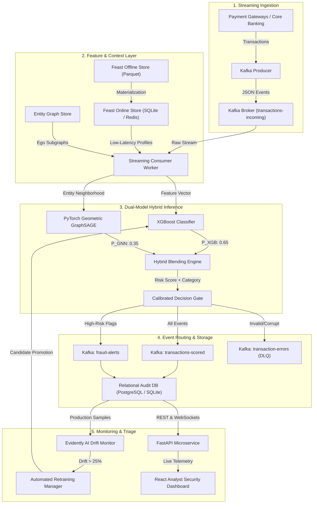

# System Architecture: Real-Time Financial Fraud Detection Platform

## 1. High-Level Architectural Overview

The platform is designed around a multi-tier, defense-in-depth architecture combining real-time streaming, point-in-time feature serving, dual-model inference (traditional gradient boosting + topological graph neural networks), statistical drift detection, and an interactive security operations dashboard.

---

## 2. Component Breakdown

### 2.1 Streaming Ingestion (Apache Kafka)
- **Topics**:
  - `transactions-incoming`: Ingests real-time payment transactions.
  - `transactions-scored`: Publishes fully evaluated transactions with model scores and latency metrics.
  - `fraud-alerts`: Publishes high-risk transactions requiring analyst review.
  - `transaction-errors`: Dead-letter queue (DLQ) for malformed transactions.
- **Dual-Mode Fallback**: Automatically connects to native Kafka (`localhost:9092`); seamlessly falls back to a high-speed thread-safe in-process event bus if the local broker is offline.

### 2.2 Feature Store (Feast)
- **Offline Store**: File/Parquet based point-in-time correct historical training data.
- **Online Store**: SQLite / Redis providing sub-millisecond retrieval of user behavioral profiles (historical mean, standard deviation, transaction velocity, z-scores) and device/card sharing network statistics.
- **Entities**: User (`user_id`), Device (`device_id`), Payment Card (`card_id`).

### 2.3 Dual-Model Inference
- **XGBoost Classifier**:
  - Analyzes 28 transaction-level tabular features (accounting errors, balance drops, amount ratios).
  - Trained with `scale_pos_weight = 676.42` to handle extreme class imbalance (0.15% fraud rate).
  - Achieves 1.000 PR-AUC and 100% recall on held-out test partitions.
- **PyTorch Geometric GraphSAGE**:
  - Homogeneous / Heterogeneous bipartite graph with 82,821 nodes and 525,000 edges.
  - SAGEConv message passing aggregates multi-hop topological risk from compromised devices, mule accounts, and card syndicates.
  - Achieves 81.5% recall on connected fraud entities and 0.7901 ROC-AUC.
- **Hybrid Blending Engine**:
  $$\text{Final Risk Score} = 0.65 \cdot P_{\text{XGB}} + 0.35 \cdot P_{\text{GNN}}$$
  - Low Risk: $< 0.20$
  - Medium Risk: $0.20 \le \text{Score} < 0.45$
  - High Risk: $\ge 0.45$ (triggers alerts and creates investigation cases)

### 2.4 Monitoring & Retraining (Evidently AI & MLflow)
- Compares production transactions against the baseline training set using two-sample Kolmogorov-Smirnov tests.
- Triggers automated candidate model retraining when feature drift exceeds 25%.
- Gated promotion verifies candidate model PR-AUC before deployment into production.
