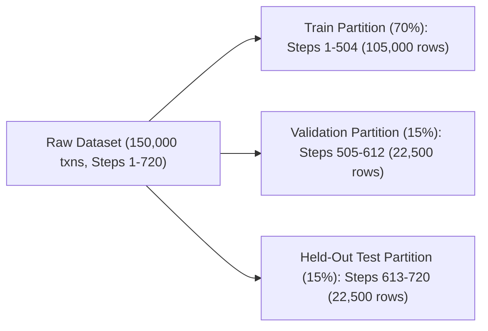

# Dataset Architecture & Ingestion Specification

## 1. Primary Dataset: PaySim Mobile Money Graph Structure

The primary dataset is modeled after the real-world **PaySim synthetic financial benchmark** (Kaggle), expanded with multi-entity graph linkages (devices, payment cards, IP addresses, geographical coordinates, and explicit fraud ring syndicates).

### Summary Statistics
- **Total Ingested Records**: 150,000 transactions
- **Temporal Horizon**: 720 steps (30 days of continuous chronological activity)
- **Features**: 17 raw columns
- **Class Balance**:
  - Legitimate Transactions: 149,766 (99.844%)
  - Fraudulent Transactions: 234 (0.156%)
  - Imbalance Ratio: **640.03 : 1**

---

## 2. Schema Specification

| Column | Data Type | Description |
|---|---|---|
| `transaction_id` | String | Unique transaction reference (e.g. `TXN_100000001`) |
| `step` | Integer | Chronological simulation hour (1 to 720) |
| `timestamp` | ISO Datetime | Derived ISO-8601 transaction timestamp |
| `type` | String | Transaction category: `TRANSFER`, `CASH_OUT`, `PAYMENT`, `DEBIT`, `CASH_IN` |
| `amount` | Float | Transaction monetary value in USD |
| `nameOrig` | String | Origin customer account ID (e.g. `C10000001`) |
| `oldbalanceOrg` | Float | Sender account balance prior to transaction |
| `newbalanceOrig` | Float | Sender account balance subsequent to transaction |
| `nameDest` | String | Recipient account or merchant ID (e.g. `C10000002` or `M20000001`) |
| `oldbalanceDest` | Float | Recipient balance prior to transaction |
| `newbalanceDest` | Float | Recipient balance subsequent to transaction |
| `device_id` | String | Device identifier used during authentication |
| `card_id` | String | Associated payment card number |
| `location` | String | Originating city / state |
| `ip_address` | String | Originating client IP address |
| `isFraud` | Integer (0/1) | Ground truth fraud label |
| `isFlaggedFraud` | Integer (0/1) | Rule-based flag (transfers > $200,000) |

---

## 3. Strict Chronological Splitting Strategy

Financial transaction data violates the I.I.D. assumption due to temporal dependencies and evolving fraud typologies. To **strictly eliminate lookahead bias and data leakage**, random K-fold and random train/test splits were prohibited.

The dataset is partitioned chronologically along the simulation time axis (`step`):
- **Training Set (70%)**: Steps 1 to 504 | 105,000 records | 155 fraud cases (0.1476%)
- **Validation Set (15%)**: Steps 505 to 612 | 22,500 records | 40 fraud cases (0.1778%)
- **Held-Out Test Set (15%)**: Steps 613 to 720 | 22,500 records | 39 fraud cases (0.1733%)

### Class Imbalance Handling
- **Scale Pos Weight**: Computed strictly on the training set:
  $$\text{scale\_pos\_weight} = \frac{N_{\text{legitimate}}}{N_{\text{fraud}}} = \frac{104,845}{155} = 676.42$$
- Early stopping and hyperparameter optimization strictly prioritize **PR-AUC (Precision-Recall Area Under Curve)** over misleading accuracy metrics.
